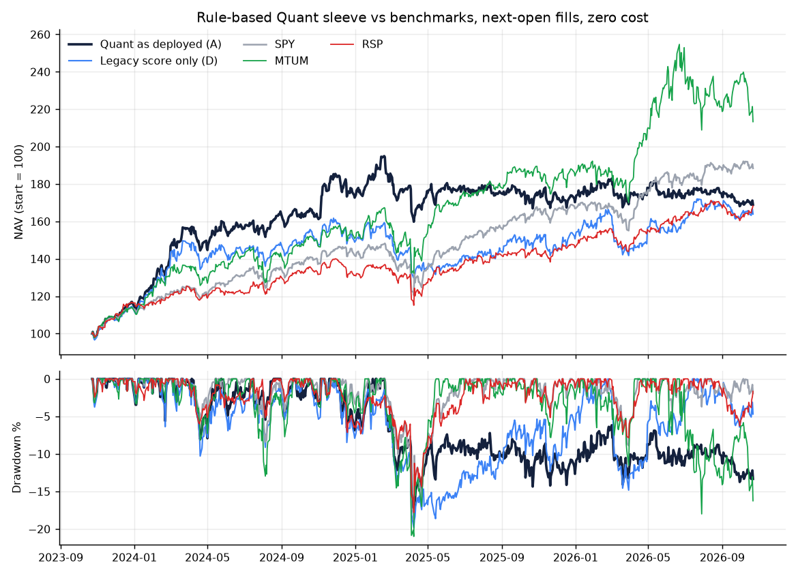
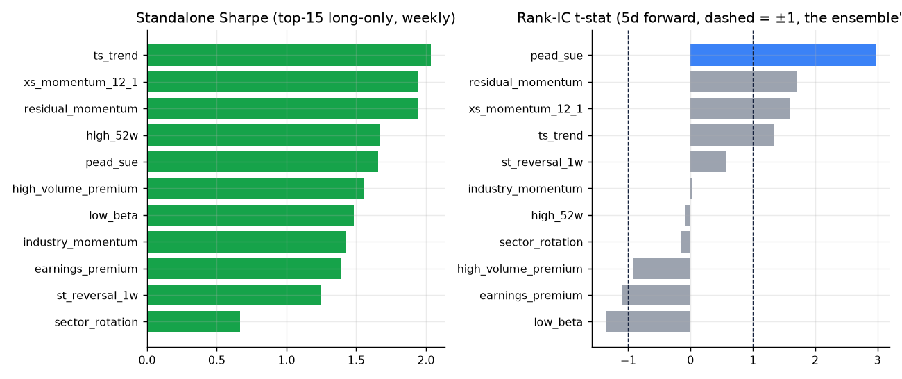
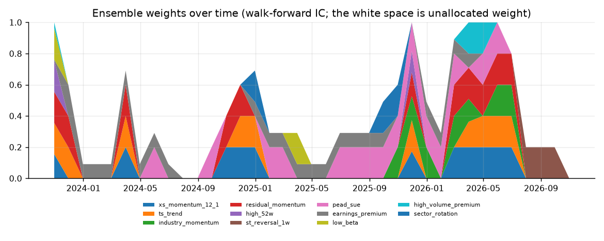
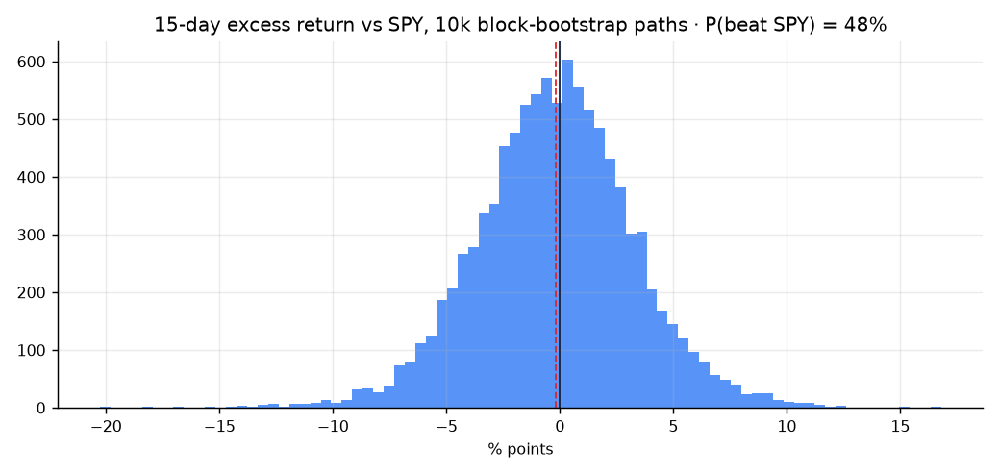

# Backtest and Monte Carlo — multi-strategy Quant sleeve (generated 2026-10-23)

**Window:** 2023-10-23 → 2026-10-22 (3 years, 2 further years of warm-up for the 252-day signals).
**What was tested:** only the rule-based parts of the fund (strategies, walk-forward IC weights, ≥3-votes entry gate, vol-managed
sizing, the real `plan_orders` with the 5-trades/day cap, the A16 drift band, trim pairing, A7/A12, the −10% stop and the −8% trailing stop).
LLM agents are excluded on purpose: a language model has read the future, so any LLM backtest leaks look-ahead.
**Fills:** next open after the signal close · **costs:** 0 (A20) except row H · **risk-free rate:** 0 · stocks only.

## Headline

Every number below is the **mean over six staggered start dates** (the same strategy started in six consecutive weeks), with the Sharpe range
shown. That range is the noise floor: the same rules gave Sharpe 0.69 to 1.21 for A depending only on which Monday the fund started, and up to
0.80 wide for other variants. **Differences smaller than that are not evidence of anything.**

Quant as deployed (A) averaged **16.1% CAGR, Sharpe 0.93, max drawdown -19.3%**
against SPY 22.4% / 1.41 / -18.8%. It did **not** beat SPY on Sharpe over this window
(first start: 1024 fills, 250 forced exits, 33 drift trims; 33 of them already had a new-name buy in the same plan,
0 needed a paired buy).
Ensemble-only (B) averaged Sharpe 1.44, the legacy Quant score (D) 0.84, the as-deployed blend (A) 0.93. The start-date ranges do not overlap, which is the only kind of gap worth noticing. A sits below B: the legacy half of the blend may be diluting the ensemble, which makes `ENSEMBLE['blend']` the one parameter worth a look (not tuned here; tuning it on this window would be curve-fitting).
Three years of one mostly bullish regime is far too little to separate skill from luck; read the rankings below as direction, not proof.

## 1. Variants vs benchmarks

| Variant | CAGR | Vol | Sharpe (range over 6 starts) | Max DD | Turnover/yr |
|---|---:|---:|---:|---:|---:|
| A. Quant as deployed (legacy + ensemble), weekly | 16.1% | 17.7% | 0.93 (0.69–1.21) | -19.3% | 13.2x |
| B. Ensemble only (IC-weighted) | 20.3% | 13.6% | 1.44 (1.13–1.82) | -12.4% | 7.8x |
| C. Ensemble only, equal-weight strategies | 17.7% | 14.4% | 1.21 (0.90–1.63) | -17.5% | 10.7x |
| D. Legacy technical score only (no ensemble) | 15.1% | 18.9% | 0.84 (0.68–1.10) | -18.9% | 13.5x |
| E. A, daily rebalance | 19.3% | 19.5% | 1.01 (0.80–1.33) | -23.3% | 26.9x |
| F. A without the >=3-votes gate | 18.5% | 17.6% | 1.06 (0.81–1.41) | -18.6% | 13.5x |
| G. A without the vol-managed overlay | 19.7% | 19.9% | 1.01 (0.81–1.19) | -21.2% | 13.0x |
| H. A with 5 bp cost per side | 16.2% | 17.6% | 0.95 (0.72–1.22) | -20.3% | 13.0x |
| SPY (buy & hold) | 22.4% | 15.2% | 1.41 (1.33–1.50) | -18.8% | – |
| MTUM (buy & hold) | 27.3% | 23.2% | 1.16 (1.11–1.24) | -21.0% | – |
| RSP (buy & hold) | 17.9% | 13.8% | 1.27 (1.19–1.36) | -17.8% | – |

A = what the Quant agent computes before the LLM sees it (`rule_score` = legacy technical score blended with the ensemble by
0.5 × the allocated ensemble weight). B/C isolate the ensemble. D is the old Quant score. E–H test one design choice at a time.
Turnover is one-way traded value per year ÷ average NAV; MTUM and RSP are buy-and-hold ETFs on the same open-to-close basis.

## 2. Profit-taking without cash and the trailing stop (B1 / B2 ablation, on A)

| Variant | CAGR | Vol | Sharpe (range over 6 starts) | Max DD | Turnover/yr |
|---|---:|---:|---:|---:|---:|
| P1. A: trim pairing ON,  trailing stop ON | 16.1% | 17.7% | 0.93 (0.69–1.21) | -19.3% | 13.2x |
| P2. A: trim pairing OFF, trailing stop ON | 16.1% | 17.7% | 0.93 (0.69–1.21) | -19.3% | 13.2x |
| P3. A: trim pairing ON,  trailing stop OFF | 18.2% | 18.0% | 1.03 (0.58–1.38) | -23.4% | 8.6x |
| P4. A: trim pairing OFF, trailing stop OFF (−10% stop only) | 18.2% | 18.0% | 1.03 (0.58–1.38) | -23.4% | 8.6x |
| P5. A: daily, trim pairing ON,  trailing ON | 19.3% | 19.5% | 1.01 (0.80–1.33) | -23.3% | 26.9x |
| P6. A: daily, trim pairing OFF, trailing ON | 19.3% | 19.5% | 1.01 (0.80–1.33) | -23.3% | 26.9x |
| P7. A: daily, trim pairing ON,  trailing OFF | 21.5% | 20.6% | 1.05 (0.79–1.23) | -23.9% | 25.8x |
| P8. A: daily, trim pairing OFF, trailing OFF | 21.5% | 20.6% | 1.05 (0.79–1.23) | -23.9% | 25.8x |

Counts in P1 (weekly, first start): 33 drift trims (33 already redeployed by the plan's own new-name buys), 0 paired buys,
250 forced exits; P4 (stop only): 82 forced exits.
The trailing stop forces roughly the extra exits you see in that difference, which is where most of the turnover comes from.

## 3. Each strategy on its own

Long-only top-15 by one strategy's sector-neutral z, equal weight, weekly, next-open fills, no costs. IC is the cross-sectional
Spearman correlation of z with the next 5-day return, daily; the t-stat uses n/5 observations because 5-day windows overlap.
**Treat the standalone CAGRs as inflated:** the universe is today's S&P 500, which contains names admitted *because* they rallied
(survivorship / index-inclusion bias hits momentum hardest). The fully constrained fund simulation in section 1 earns far less.

| Strategy | Standalone Sharpe | CAGR | Mean IC | IC t | Turnover/yr |
|---|---:|---:|---:|---:|---:|
| xs_momentum_12_1 | 1.95 | 94.0% | 0.0220 | 1.60 | 3.6x |
| ts_trend | 2.03 | 67.7% | 0.0192 | 1.34 | 4.2x |
| industry_momentum | 1.42 | 28.2% | 0.0002 | 0.03 | 6.3x |
| residual_momentum | 1.94 | 54.3% | 0.0244 | 1.71 | 4.3x |
| high_52w | 1.66 | 27.5% | -0.0012 | -0.09 | 12.3x |
| st_reversal_1w | 1.25 | 34.9% | 0.0061 | 0.58 | 23.6x |
| pead_sue | 1.66 | 42.7% | 0.0149 | 2.98 | 6.1x |
| earnings_premium | 1.39 | 29.9% | -0.0098 | -1.09 | 20.8x |
| low_beta | 1.48 | 19.6% | -0.0277 | -1.37 | 1.5x |
| high_volume_premium | 1.56 | 30.3% | -0.0050 | -0.91 | 21.5x |
| sector_rotation | 0.67 | 13.5% | -0.0020 | -0.14 | 6.0x |

Not backtestable (no point-in-time history): `eps_revisions`, `quality_gp` (gross-margin/ROA proxy), `insider_buying`, `news_surprise`
(only today's snapshot exists; FinBERT/news history does not). `turn_of_month` is a tilt, tested as a market-timing statistic:
SPY averaged 8.5 bp/day inside the 136-day window versus 8.9 bp outside (t = -0.05).
`etf_trend_200dma` is tested on the 14 leveraged long ETFs, equal weight, in/out of the 200dma:

| Leveraged-ETF filter | Sharpe | CAGR | Max DD |
|---|---:|---:|---:|
| leveraged ETFs, 200dma filter | 1.02 | 39.9% | -39.7% |
| leveraged ETFs, always held | 1.21 | 58.5% | -53.8% |

## 4. Ablation: drop one strategy (ensemble-only variant B, base Sharpe 1.44)

| Dropped strategy | Sharpe w/o it | Δ Sharpe | CAGR | Max DD |
|---|---:|---:|---:|---:|
| xs_momentum_12_1 | 1.37 | -0.07 | 18.7% | -14.0% |
| ts_trend | 1.52 | +0.08 | 21.9% | -13.2% |
| industry_momentum | 1.58 | +0.14 | 22.6% | -13.2% |
| residual_momentum | 1.75 | +0.31 | 25.4% | -14.8% |
| high_52w | 1.77 | +0.33 | 25.7% | -14.3% |
| st_reversal_1w | 1.54 | +0.10 | 22.3% | -14.4% |
| pead_sue | 1.24 | -0.20 | 17.0% | -15.1% |
| earnings_premium | 1.69 | +0.25 | 26.4% | -12.3% |
| low_beta | 1.54 | +0.10 | 23.2% | -14.1% |
| high_volume_premium | 1.34 | -0.10 | 18.8% | -16.8% |
| sector_rotation | 1.36 | -0.08 | 19.0% | -15.5% |

With 11 strategies and a 3-year window most Δ Sharpe values are inside the noise of the test; a drop that *raises* Sharpe is a
reason to look, not to delete. Ensemble weights on the last day: none cleared t ≥ 1.

## 5. Monte Carlo — 15 trading days, 10,000 block-bootstrap paths

Blocks of 5 days drawn jointly from the fund's and SPY's daily returns (their correlation is kept); 3 blocks per path.
Drawdown is measured inside the 15-day path from its own running peak.

| Path source | P(beat SPY) | P(DD ≤ −7%) | P(DD ≤ −10%) | P(loss) | 15d return p5/p50/p95 | Excess p5/p50/p95 |
|---|---:|---:|---:|---:|---:|---:|
| A. Quant as deployed | 48% | 6% | 1% | 38% | -5.3% / 1.1% / 8.0% | -5.8% / -0.2% / 5.4% |
| D. Legacy only | 48% | 9% | 2% | 39% | -6.0% / 1.2% / 8.2% | -6.3% / -0.2% / 5.6% |
| SPY alone (vs itself, for scale) | 0% | 3% | 1% | 33% | -4.0% / 1.4% / 7.1% | 0.0% / 0.0% / 0.0% |

P(beat SPY) near 50% means the sleeve is indistinguishable from the index over a 15-day race, which is the honest prior for the
class competition: with this horizon, the P&L ranking is mostly noise.

## 6. Known biases and limits (state these on the slide)

- **Survivorship:** the universe is today's S&P 500 constituents; names that were dropped from the index (usually losers) are absent, so every long-only number is flattered.
- **Frozen fundamentals / no fundamentals at all:** quality, estimate revisions and the Research agent cannot be replayed point-in-time, so they are not in the backtest. Sector/industry labels are today's GICS.
- **No historical news:** `news_surprise`, the Sentiment agent and the politician-trades context are not backtested; the C4 news veto is not exercised.
- **Earnings data:** EPS surprises come from yfinance's history (reported values, some restatement risk); `earnings_premium` uses the realised report dates, which companies announce weeks ahead (small look-ahead if a date moved).
- **Not in the loop:** LSTM / Kronos / LightGBM, regime rules, leveraged-ETF trading, the mean-variance optimiser (a rule-based weighting stands in), PM/Risk/CIO judgement. This is the Quant sleeve, not the fund.
- **Single regime, 3 years:** one bull-market window, ablations are multiple comparisons on the same data; none of the differences is claimed significant.
- **Design parameters** (blend 0.5, 20% cap, 60-session IC, −8% trailing stop, 15 names, 5-day cooldown after a stop) were fixed in advance, not tuned on this sample.
- **Monte Carlo** resamples this same in-sample history; it states the spread of 15-day outcomes, not a forecast.

_Generated by `backtest/run_backtest.py` in 387s from `data/cache/bt/` (prices + earnings history)._
